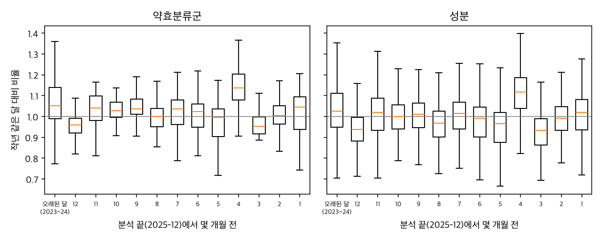
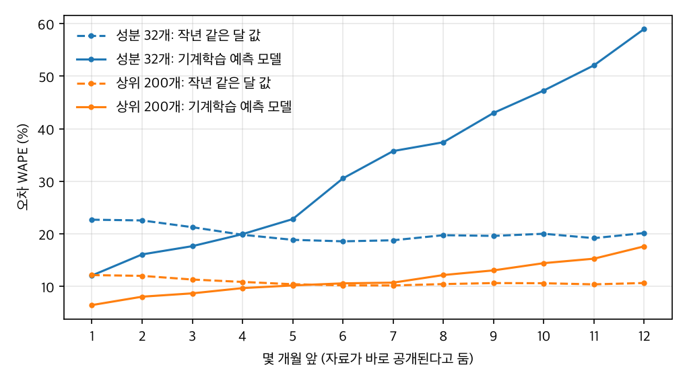

# P2 최소판 결과 (T1 · T2 · T3)

> 숫자는 `scripts/p2_min_report.py`가 `outputs/p2/`의 CSV(이번 실행 산출, 표마다 출처를 적음)에서 읽어 쓴 것이다. 설계: [PLAN_P2](../docs/PLAN_P2.md) §7 최소판, 결정: [DECISIONS](../docs/DECISIONS.md) "P2 최소판", 검토: [REVIEW](REVIEW_2026-11-18.md)·[WORKLOG](WORKLOG_2026-11-18.md).

**결론**: 이 설정(성분 32개, 신호가 0이 아닌 칸 2~11%, 전국 단위, 공개 시차 5개월)에서는 다음 달 예측에서 M2도 12개월 전 값(M0)보다 나빴고, 선행 신호 특징(M3)은 M2를 개선하지 못했다. 주입 시험에서 20% 효과도 일부만 검출되어, 신호 효과를 검출할 힘이 부족했다. 실제 사건을 미리 넣은 오라클과 시점 이동(−3~+3개월)으로도 개선되지 않았고, 청구금액을 목표로 한 오라클에서도 개선이 없었다. 가격 몫이 금액 변화 분산의 3~4%에 그쳐 실제 가격 변화를 미리 알아도 개선 상한이 2% 안팎이었다. 신호가 있는 학습 행이 적은 것(27~334행)도 원인일 수 있으나, 따로 검증하지 않았다.

(보충) 상위 200개·층화 200개에서는 시차 5에서도 M2가 M0보다 오차가 작았다(추가 확인 D). 선행 신호 특징이 개선하지 못한 결과는 세 대상 모두에서 같았다.

**주 결과의 숫자 (공개 시차 5개월, 예측 대상 = 발간월 M의 다음 달 M+1)**: 전역 모델 M2의 MASE 1.202는 12개월 전 값 M0 0.923보다 나빴다 (M2가 나은 성분 1/32). P1 신호 특징을 넣은 M3 1.350는 M2보다 나빴다 (M3가 나은 성분 2/32, Holm 보정 뒤 판정: M2가 나음). 이 악화의 약 절반은 신호 내용이 아니라 신호 열의 결측 구조(2022 이전 NaN)가 만든 시기 표시에서 왔다(§5). 신호가 0이 아닌 칸 비율은 lag 0 1.9%, lag 5 10.6% (출처: `outputs/p2/t3_features.csv`). 공개 시차를 0으로 둔 이상적 가정(부록 A)에서만 M2가 M0보다 나았다.

## 먼저 읽을 한계

- **전국 성분 단위의 원외 청구수량 예측**이다. 약국 단위 구매·재고·판매, 제품별 판매량, 도매 유통은 데이터에 없다.
- **대상 선정에 평가 기간의 정보가 들어 있다.** 대상 32개는 2018-01 ~ 2025-12 96개월 내내 관측된 성분이다(평가 끝까지 살아남은 성분, 생존 편향). 주력 묶음은 2022~2025 겨울/여름 비율로 골랐고, 규모 조건은 2022 원외 청구수량이다(lag 5의 첫 origin 2023-01은 2022-08까지만 볼 수 있다). 진입·퇴출·비공개 전환처럼 어려운 사례가 빠져 결과가 실제보다 좋게 나올 수 있다.
- 대상은 2022 원외 청구금액의 5.9%, 수량의 16.9%다. 업체 2곳 이하 성분은 사용통계에 없다.
- 사용통계는 2026-11-01에 받은 **수정본**으로 학습·평가했다. 실제 발간 시점에는 초본이라 결과가 낙관적일 수 있다 (BACKLOG X11). 시험으로는 잡을 수 없다.
- P1 규칙(v5.3)은 2022~2025 전체 결과와 holdout 불일치를 보고 고쳤다. as-of 재빌드는 같은 규칙을 과거 스냅샷으로 다시 돌릴 뿐이라, 규칙을 고를 때 쓴 미래 지식은 남는다. 외부 근거(경보제약)를 어떤 사례에 넣을지도 결과를 보고 골랐다. 미리 잠가 둔 시간 holdout은 없다.
- 하이퍼파라미터·특징·창은 결과를 보기 전에 정했고 조정하지 않았다. 아래 진단 실험은 원인 후보를 가르는 데만 쓰고 주 모델을 바꾸지 않았다.
- 검정은 성분 32개의 평균 오차 차이에 대한 것이다. 성분들은 같은 origin을 공유해 서로 독립이 아니므로 p값은 낙관적일 수 있다.

## 집행정지로 막힌 신호와 미결의 처리 (지시 3)

- 원장의 '미결(집행정지 중)'·'미실현'은 뒤 스냅샷으로 정해지는 값이다. 특징에 쓰면 누수라 쓰지 않는다 (`src/pbd/ledger/posthoc.py`, 시험 `test_p2_posthoc.py`).
- 대신 **origin 시점 목록에 집행정지 표시가 보이는 제품**(표시 첫 달 ≤ s < 표시가 처음 사라진 달)의 약가·급여중지 예고를 '실현될 인하·중지'로 넣지 않는다.
- 외부 근거로만 넣은 집행정지(경보제약, 결정 2025-07-09)는 결정일 다음 달 스냅샷(2025-08)부터 보인 것으로 친다. 그래서 2025-06·2025-07 origin에서는 경보제약 급여중지 예고가 '막히지 않은 예고'로 들어간다. 그 시점에 알 수 있던 정보가 그랬기 때문이다.
- 제품 상태는 `state_as_known`만 쓴다(뒤 스냅샷으로 고쳐 쓴 `revised` 칸을 읽지 않음). 최종 결과로 거르면 특징이 달라진다는 것을 누수 주입 시험으로 확인했다(아래).

## 가상 재고 시뮬레이션의 가정 (지시 4, 결과보다 먼저)

- **전국 성분 단위 가상 재고 시뮬레이션**이다. 약국 재고 최적화가 아니다. 시도 단위도 아니다(PLAN_P2 §6은 시도 × 성분).
- 결품 비용 / 재고 비용 = **1, 3, 9 (가정값)** → 목표 재고 = 분위 τ = 0.5, 0.75, 0.9 예측. 비용 비율마다 따로 학습한다.
- **달마다 독립(이월 없음)**: 그 달 목표 재고 S로 그 달 수요 D를 맞고, 남은 재고는 다음 달로 넘기지 않는다. PLAN_P2 §6의 '발주 = 목표 − 현재 재고'와 다르다.
- 리드타임 1개월 = origin M에 정한 S가 M+1에 쓰인다. 실제 수요 = 사용통계 실측(수정본).
- 정책: 기준 M0 × 1.1(안전계수 0.1, 가정값) / **M0 분위**(y_{t−12} × 과거 계절 비율 y_u/y_{u−12}의 τ 분위. 분위 형태의 기준이지만 포함률은 보정하지 않았다. 비율 이력은 M − lag까지라 lag마다 값이 다르다) / M2 분위·M3 분위(LightGBM 분위 회귀). 포함률(실수요 ≤ S인 칸 비율)이 τ 근처면 분위가 맞은 것이다.

## 완료 기준별 통과 여부

| 단계 | 완료 기준 | 결과 |
|---|---|---|
| T1 | 원본 재집계 합 = 마트 합 | 통과: 원본 CSV 96개를 따로 읽어 성분4 × 월 원외 합 61,122칸 비교, 차이 0칸, 한쪽에만 있는 칸 0 (출처: `outputs/p2/t1_reagg_check.csv`) |
| T1 | 비공개 칸은 미관측 | 통과: 원본 행이 없는 칸은 claim_qty = NULL, observed = false (합성 시험) |
| T1 | 첫 관측월 제외 규칙 시험 | 통과: 자료 시작월이 아닌 첫 관측월은 usable = false (합성 시험) |
| T1 | 대상 선정 탈락 단계표 | 아래 §1 |
| T2 | 누수 시험 (미래 행을 바꾸거나 지워도 과거 origin 예측 불변, 허용오차 0) | 통과: M0(origin 3개 × lag 0·3·5), M2(lag 0·3·5). 학습 목표 달 ≤ M − lag 시험. **누수 주입 3가지(자르지 않은 입력 / lag 무시 / 공백 구간 실측을 학습 목표로)를 시험이 잡음** |
| T3 | origin 이후 스냅샷을 지워도 특징·예측이 같음 | 통과: 2023-06·2025-07·2025-10 이하 스냅샷만으로 v5 원장을 다시 만들어(build_asof) 특징 비교(lag 0·3·5, 허용오차 0). 2025-07·2025-10에서는 **M3 학습 행 전체(2022-01 ~ origin)의 특징과 M3 예측**까지 같음(lag 0·5). 누수 주입 2가지(s 뒤 신호 사용 / 최종 결과로 거르기)를 시험이 잡음 |
| T3 | M3 대 M2 (origin 2023-01 이후) | 아래 §3. 유의하지 않으면 "차이 없음" |
| 시험 | P2 시험 4개 파일 (사후 칸 시험 `test_p2_posthoc.py` 포함) | 이번 실행: `46 passed in 341.72s (0:05:41)`. 전체 `make test`는 WORKLOG |

## 1. T1 대상 선정 탈락 단계

| 단계 | 성분4 | 탈락 |
|---|---|---|
| ① 사용통계에 있는 성분4 | 996 |  |
| ② 원외 관측 1개월 이상 | 948 | 48 |
| ③ 주력 묶음 분류 (141·222·229·618) | 106 | 842 |
| ④ 96개월 원외 모두 관측 | 49 | 57 |
| ⑤ 2022 원외 청구수량 상위 200 | 32 | 17 |

대상 분류별: 141 6개, 222 12개, 229 3개, 618 11개. 출처: `outputs/p2/t1_target_steps.csv`, `outputs/p2/t1_target.csv`, `outputs/p2/t1_coverage.csv`

## 2. 주 결과: lag 5 오차 (origin 2023-01 ~ 2025-11, 35개 × 성분 32, 예측 대상 M+1)

| 모델 | MASE | WAPE | 청구금액 가중 WAPE |
|---|---|---|---|
| M0 | 0.923 | 23.9% | 20.1% |
| M2 | 1.202 | 29.1% | 26.5% |
| M3 | 1.350 | 33.0% | 30.9% |
| M3p | 1.322 | 32.4% | — |

평가 칸 1,120개. M0 = 12개월 전 값, M2 = LightGBM 전역(목표 log(y_t / y_a), a = 마지막 관측월), M3 = M2 + 신호(기준 스냅샷 M), M3p = 기준 스냅샷 M−1(보수적 민감도). MASE 척도 = 성분마다 2018-01 ~ 2022-12의 계절(12) 단순 예측 평균 절대오차(고정). 달력상 첫 origin 이전이지만 lag 5의 첫 origin(2023-01)에서는 2022-09 ~ 12가 아직 공개 전이다. 예측에는 쓰지 않는 지표 척도라 예측 누수는 아니다. 출처: `outputs/p2/t3_errors.csv`

| 구분 | 칸 | M0 | M2 | M3 | M3p |
|---|---|---|---|---|---|
| origin에 창 안 신호 있음 | 156 | 0.609 | 1.380 | 1.471 | 1.531 |
| 비유행기 | 672 | 0.944 | 1.293 | 1.455 | 1.420 |
| 신호 없음 | 964 | 0.974 | 1.173 | 1.330 | 1.288 |
| 유행기(11~3월) | 448 | 0.893 | 1.065 | 1.192 | 1.175 |

## 3. M3 대 M2, M2 대 M0 (검정)

성분별 평균 MASE 차이(a − b, 음수 = a가 나음)에 부호 검정·Wilcoxon 부호 순위 검정. 두 검정 모두 p < 0.05일 때 차이로 쓴다. Holm 보정은 부호 검정과 Wilcoxon 검정에 따로, 각각 이 표의 비교 6개를 한 묶음으로 했다. Holm 뒤 판정 = 보정된 두 p가 모두 0.05 미만. §4 금액 표는 그 표 6개, §5 진단 표는 진단 비교 22개, §5b 표는 20개를 각각 한 묶음으로 보정했다. 상대 차이 = a MASE ÷ b MASE − 1.

| lag | a − b | a MASE | b MASE | 상대 차이 | a가 나은 성분 | 부호 p | Wilcoxon p | 부호 p (Holm) | Wilcoxon p (Holm) | 판정 | Holm 뒤 판정 |
|---|---|---|---|---|---|---|---|---|---|---|---|
| 5 (주) | M3 − M2 | 1.350 | 1.202 | +12.3% | 2/32 | 0.0000 | 0.0000 | 0.0000 | 0.0000 | M2가 나음 | M2가 나음 |
| 5 (주) | M3p − M2 | 1.322 | 1.202 | +10.0% | 6/32 | 0.0005 | 0.0000 | 0.0016 | 0.0000 | M2가 나음 | M2가 나음 |
| 5 (주) | M2 − M0 | 1.202 | 0.923 | +30.1% | 1/32 | 0.0000 | 0.0000 | 0.0000 | 0.0000 | M0가 나음 | M0가 나음 |
| 0 (참고) | M3 − M2 | 0.549 | 0.538 | +1.9% | 8/32 | 0.0070 | 0.0032 | 0.0140 | 0.0063 | M2가 나음 | M2가 나음 |
| 0 (참고) | M3p − M2 | 0.543 | 0.538 | +0.9% | 12/32 | 0.2153 | 0.0837 | 0.2153 | 0.0837 | 차이 없음 | 차이 없음 |
| 0 (참고) | M2 − M0 | 0.538 | 0.923 | -41.7% | 32/32 | 0.0000 | 0.0000 | 0.0000 | 0.0000 | M2가 나음 | M2가 나음 |

출처: `outputs/p2/t3_compare.csv`. 신호 특징이 0이 아닌 성분·origin 칸 비율(분모 = 특징표 전체: origin 2022-01 ~ 2025-11 47개 × 성분, 학습 행 포함. §2의 '신호 있음' 칸 수는 평가 칸 1,120개 중 창 안 신호가 하나라도 있는 칸, E6 주입 칸은 그중 인하 예고가 있는 칸이라 서로 다르다): lag 0 1.9%, lag 5 10.6%. 특징별(세 lag 합): 인하 예고 5.8%, 급여중지 예고 0.4%, 등재 예고 0.0% (출처: `outputs/p2/t3_features.csv`).

lag 0의 M3 − M2 차이는 상대 +1.9%로 작다. 통계적으로는 M2가 낫지만 실무상 차이는 작다.

origin별 (lag 5): M3 − M2 평균 차이가 양수(M3가 나쁨)인 origin 27/35개. 가장 큰 3개 origin(2025-03 +0.686, 2025-02 +0.645, 2023-11 +0.642)을 빼도 평균 차이 +0.100. 몇 달에 몰린 차이가 아니다 (출처: `outputs/p2/t3_pred.csv`).

## 4. 청구금액 긍정 대조 (지시 5)

가설: 약가 인하 예고는 수량보다 금액(= 수량 × 단가)에 먼저 나타나야 한다. 같은 M2·M3·M3p를 목표 = 원외 청구금액으로 돌렸다. 금액에서 M3가 나아지면 '목표 변수가 수량이라 신호가 담을 정보가 없다'(검토 b1) 쪽, 금액에서도 나빠지면 특징·모델 쪽이다.

| lag | a − b | a MASE | b MASE | 상대 차이 | a가 나은 성분 | 판정 | Holm 뒤 판정 |
|---|---|---|---|---|---|---|---|
| 5 | M3 − M2 | 1.478 | 1.317 | +12.2% | 3/32 | M2가 나음 | M2가 나음 |
| 5 | M3p − M2 | 1.451 | 1.317 | +10.1% | 3/32 | M2가 나음 | M2가 나음 |
| 5 | M2 − M0 | 1.317 | 0.915 | +44.0% | 2/32 | M0가 나음 | M0가 나음 |
| 0 | M3 − M2 | 0.573 | 0.560 | +2.5% | 4/32 | M2가 나음 | M2가 나음 |
| 0 | M3p − M2 | 0.569 | 0.560 | +1.7% | 10/32 | 차이 없음 | 차이 없음 |
| 0 | M2 − M0 | 0.560 | 0.915 | -38.8% | 32/32 | M2가 나음 | M2가 나음 |

출처: `outputs/p2/t3_compare_claim_amt.csv`. **금액에서도 M3는 M2보다 나아지지 않았다** (lag 5 M2가 나음, Holm 뒤). 목표 변수 불일치만으로는 설명되지 않는다. 다만 긍정 대조가 실패한 것이 신호의 쓸모를 판정하지는 않는다. E6에서 일부러 넣은 20% 효과도 일부만 검출됐으므로(§5), 이 틀의 검정력이 모자란 것과 구분되지 않는다. 말할 수 있는 것은 '이 특징 정의와 이 모델에서는 금액 예측도 나아지지 않았다'까지다.

## 5. 진단 실험 (검토 b 항목, 주 모델은 바꾸지 않음)

| 실험 | 후보 | lag | a MASE | b MASE | 상대 차이 | 판정 |
|---|---|---|---|---|---|---|
| E1 신호 열 0 − M2 | b7 구현 | 5 | 1.275 | 1.202 | +6.1% | M2가 나음 |
| E2 신호 섞음 − M2 | b3 열 추가 잡음 | 5 | 1.292 | 1.202 | +7.6% | M2가 나음 |
| E2 섞음 − E1 | 열 추가 잡음 | 5 | 1.292 | 1.275 | +1.4% | 차이 없음 |
| E3 n_prod 뺀 M3 − M2 | b4 조밀 수준 변수 | 5 | 1.331 | 1.202 | +10.8% | M2가 나음 |
| E3 − E1 | n_prod | 5 | 1.331 | 1.275 | +4.4% | E1_null가 나음 |
| E4 대상 달 2022-02 이후 학습 M2 − M2 | 학습 기간 | 5 | 1.372 | 1.202 | +14.2% | M2가 나음 |
| E4 대상 달 2022-02 이후 학습 M3 − M2 | b5 NaN = 시기 표시 | 5 | 1.421 | 1.372 | +3.6% | 차이 없음 |
| E5 계절 목표 M2s − M2 | b8 기반 모델 | 5 | 1.267 | 1.202 | +5.4% | 차이 없음 |
| E5 계절 목표 M3s − M2s | b8 기반 모델 | 5 | 1.366 | 1.267 | +7.8% | E5_M2s가 나음 |
| 기준 M3 − M2 |  | 5 | 1.350 | 1.202 | +12.3% | M2가 나음 |
| **M3 − E1** (시기 표시를 같게 둔 신호 내용의 몫) | 신호 내용 | 5 | 1.350 | 1.275 | +5.9% | E1_null가 나음 |

세 lag 전체는 출처: `outputs/p2/exp_compare.csv`. 모델별 MASE (lag × 모델): 출처: `outputs/p2/exp_mase_by_model.csv`.

| lag | E1: 신호 열 0인 M3 = M2 (바이트 같음) | E0: 시드만 바꾼 M3 = M3 |
|---|---|---|
| 5 | 다름 | 같음 (origin 2024-06) |
| 0 | 다름 | 같음 (origin 2024-06) |

출처: `outputs/p2/exp_null_seed.csv`. E1의 정의: 특징표의 행(origin 2022-01 이후)만 신호 열을 0으로 바꿨고, 2022-01 이전 pseudo-origin은 특징표에 행이 없어 NaN으로 남는다. E0은 origin 하나(2024-06)에서만 확인했다. subsample = colsample = 1이라 학습이 결정적이다.

E1′ (검토 2차 r2-3, 두 해석을 가르는 실험): 2022 이전 행까지 신호 열을 0으로 채운 진짜 상수 열 / E1과 같은 'NaN → 0' 구조를 다시 만든 열 (출처: `outputs/p2/exp_e1_constant.csv`).

| lag | 상수 열 = M2 (바이트) | 상수 열 MASE | NaN→0 열 = M2 | NaN→0 열 MASE | M2 MASE |
|---|---|---|---|---|---|
| 5 | 같음 | 1.202 | 다름 | 1.275 | 1.202 |
| 0 | 같음 | 0.538 | 다름 | 0.551 | 0.538 |

상수 열은 M2와 바이트 단위로 같고, 'NaN → 0' 열만 M2와 달라진다. 구현 차이(검토 b7)는 없고, E1의 악화는 결측 구조가 만든 시기 표시에서 온다.

E6 합성 효과 주입 (인하 예고가 있는 칸의 실측 수량 × 0.8, 학습·평가 모두): 주입 칸과 나머지 칸의 MASE (출처: `outputs/p2/exp_inject.csv`).

| lag | 모델 | 주입 칸 | 칸 수 | MASE |
|---|---|---|---|---|
| 0 | E6_M2 | 아니오 | 1093 | 0.558 |
| 0 | E6_M2 | 예 | 27 | 0.936 |
| 0 | E6_M3 | 아니오 | 1093 | 0.566 |
| 0 | E6_M3 | 예 | 27 | 0.941 |
| 5 | E6_M2 | 아니오 | 972 | 1.079 |
| 5 | E6_M2 | 예 | 148 | 2.136 |
| 5 | E6_M3 | 아니오 | 972 | 1.283 |
| 5 | E6_M3 | 예 | 148 | 1.974 |

E5 계절 목표 M2s의 MASE (lag별): lag 0 0.589 (M0 0.923, M2 0.538), lag 5 1.267 (M0 0.923, M2 1.202).

**읽기 (lag 5)**: 신호 열을 모두 0으로 둔 E1이 M2와 같지 않았다. 2022-01 이전 pseudo-origin은 특징 행이 없어 NaN이고 이후는 값이 있으므로, 신호 열이 내용 없이도 **'2022 이전 / 이후' 시기 표시**로 작동한다(검토 b5의 구조, 단 0이 아니라 NaN). M3 − M2 +12.3% 중 시기 표시(E1 − M2)가 +6.1%, 시기 표시를 같게 둔 신호 내용(M3 − E1)이 +5.9%다. (E1′로 확인). lag 0에서 M3 − E1은 -0.4%(차이 없음)다. 2022-02 이후 행으로만 학습하면(E4) lag 0에서 M3가 M2보다 나았다(-1.6%, Holm 뒤 E4_M3_2022가 나음). 다만 2022 이후 학습은 M2 자체를 크게 나쁘게 한다. 시드는 결과를 바꾸지 않았다(E0). 합성 효과 주입(E6, 인하 예고가 있는 칸의 수량 20% 감소): 주입 칸 MASE M3 대 M2 = lag 0 0.941 대 0.936, lag 5 1.974 대 2.136. lag 0: 주입 칸 27개, M3가 오차를 줄이지 못함(검출 못 함); lag 5: 주입 칸 148개, M3가 오차를 줄임(일부 검출). 주입 칸이 아닌 칸에서는 M3가 M2보다 나빴다. 즉 이 틀은 20% 크기의 효과도 일부만 되찾는다. 후보별 판정은 [WORKLOG](WORKLOG_2026-11-18.md) §2.

**하지 않은 진단** (검토 b10·b11·b12 일부·b13): 특징 인코딩 비교, 대상 성분 확대, M2·M3 따로 튜닝, origin 블록 부트스트랩, 시드 여러 개 분포, 분위 포함률 보정. as-of 예측 비교는 origin 2개(2025-07·2025-10) × lag 0·5만 했다. (b6 시점 이동·b9 오라클은 아래 §5b)

## 5b. 오라클 상한(b9)과 특징 시점 이동(b6)

- **오라클 M3o**: 신호 특징 대신 사후 원장의 실제 이벤트(창 안에 유효일이 있는 약가 변경(예고 여부 무관)·등재·삭제·급여중지)를 넣었다. **일부러 미래를 본 상한 실험**이다. 비교 기준은 같은 결측 구조를 가진 E1(신호 열 0)이다.
- **시점 이동 M3(k)**: 신호 창을 k개월 옮겼다(a+1+k ~ t+k). 기준 스냅샷은 M 그대로라 누수가 아니다.

| lag | a − b | a MASE | b MASE | 상대 차이 | a가 나은 성분 | Holm 뒤 판정 |
|---|---|---|---|---|---|---|
| 5 | M3_off+0 − E1_null | 1.350 | 1.275 | +5.9% | 5/32 | E1_null가 나음 |
| 5 | M3_off+1 − E1_null | 1.334 | 1.275 | +4.7% | 6/32 | E1_null가 나음 |
| 5 | M3_off+2 − E1_null | 1.321 | 1.275 | +3.7% | 8/32 | 차이 없음 |
| 5 | M3_off+3 − E1_null | 1.321 | 1.275 | +3.6% | 7/32 | E1_null가 나음 |
| 5 | M3_off-1 − E1_null | 1.349 | 1.275 | +5.8% | 5/32 | E1_null가 나음 |
| 5 | M3_off-2 − E1_null | 1.330 | 1.275 | +4.3% | 7/32 | E1_null가 나음 |
| 5 | M3_off-3 − E1_null | 1.310 | 1.275 | +2.8% | 9/32 | 차이 없음 |
| 5 | M3o_oracle − E1_null | 1.350 | 1.275 | +5.9% | 8/32 | 차이 없음 |
| 5 | M3o_oracle − M2 | 1.350 | 1.202 | +12.4% | 5/32 | M2가 나음 |
| 5 | M3o_oracle_2022 − M2_2022 | 1.418 | 1.372 | +3.4% | 11/32 | 차이 없음 |
| 0 | M3_off+0 − E1_null | 0.549 | 0.551 | -0.4% | 17/32 | 차이 없음 |
| 0 | M3_off+1 − E1_null | 0.550 | 0.551 | -0.2% | 16/32 | 차이 없음 |
| 0 | M3_off+2 − E1_null | 0.550 | 0.551 | -0.2% | 16/32 | 차이 없음 |
| 0 | M3_off+3 − E1_null | 0.550 | 0.551 | -0.2% | 16/32 | 차이 없음 |
| 0 | M3_off-1 − E1_null | 0.554 | 0.551 | +0.6% | 13/32 | 차이 없음 |
| 0 | M3_off-2 − E1_null | 0.557 | 0.551 | +1.1% | 10/32 | 차이 없음 |
| 0 | M3_off-3 − E1_null | 0.549 | 0.551 | -0.3% | 17/32 | 차이 없음 |
| 0 | M3o_oracle − E1_null | 0.548 | 0.551 | -0.6% | 16/32 | 차이 없음 |
| 0 | M3o_oracle − M2 | 0.548 | 0.538 | +1.7% | 10/32 | 차이 없음 |
| 0 | M3o_oracle_2022 − M2_2022 | 0.608 | 0.616 | -1.4% | 24/32 | 차이 없음 |

출처: `outputs/p2/diag_compare.csv`, `outputs/p2/diag_mase.csv`, `outputs/p2/diag_coverage.csv`. 0이 아닌 칸 비율(특징표 전체): lag 5 오라클 31.4% / 신호 10.6%, lag 0 오라클 7.0% / 신호 1.9%.

- lag 5: 오라클 − E1 +5.9% (차이 없음), 같은 학습 기간(대상 달 2022-02~) 오라클 − M2 +3.4% (차이 없음). 시점 이동 중 MASE가 가장 낮은 k = -3 (MASE 1.310, k = 0은 1.350).
- lag 0: 오라클 − E1 -0.6% (차이 없음), 같은 학습 기간(대상 달 2022-02~) 오라클 − M2 -1.4% (차이 없음). 시점 이동 중 MASE가 가장 낮은 k = +0 (MASE 0.549, k = 0은 0.549).

**금액 목표 오라클** (금액은 가격 변화를 기계적으로 반영하므로 개선되는지 확인, 시점 이동은 돌리지 않음):

| lag | a − b | a MASE | b MASE | 상대 차이 | a가 나은 성분 | Holm 뒤 판정 |
|---|---|---|---|---|---|---|
| 5 | M3o_oracle − E1_null | 1.477 | 1.412 | +4.6% | 9/32 | 차이 없음 |
| 5 | M3o_oracle − M2 | 1.477 | 1.317 | +12.1% | 6/32 | M2가 나음 |
| 5 | M3o_oracle_2022 − M2_2022 | 1.644 | 1.624 | +1.2% | 14/32 | 차이 없음 |
| 0 | M3o_oracle − E1_null | 0.575 | 0.576 | -0.2% | 17/32 | 차이 없음 |
| 0 | M3o_oracle − M2 | 0.575 | 0.560 | +2.7% | 6/32 | M2가 나음 |
| 0 | M3o_oracle_2022 − M2_2022 | 0.646 | 0.640 | +1.0% | 9/32 | 차이 없음 |

출처: `outputs/p2/diag_compare_claim_amt.csv`. Holm 보정은 이 표 6개를 한 묶음으로.

**오라클 특징 점검** (금액 오라클이 개선되지 않은 원인, `scripts/p2_check_oracle_features.py`):

| lag | 평가 칸 | 가격 특징 ≠ 0 칸 | 특징-실제 단가 변화 상관 (전체 / ≠0) | 기울기 (≠0) | 금액 변화 분산 중 단가 몫 | 개선 상한 1 − √(1 − 단가 몫) | 0이 아닌 학습 행 (origin별 최소 ~ 최대) / 전체 학습 행 |
|---|---|---|---|---|---|---|---|
| 5 | 1120 | 301 | 0.58 / 0.80 | 0.82 | 3.6% | 1.8% | 27 ~ 334 / 1,248 ~ 2,336 |
| 0 | 1120 | 59 | 0.49 / 0.91 | 0.91 | 3.2% | 1.6% | 7 ~ 66 / 1,568 ~ 2,656 |

출처: `outputs/p2/oracle_check.csv`, `outputs/p2/oracle_check_train.csv`. 가격 변경 이벤트의 성분 코드와 그 달 제품 성분 코드 일치 100.0%. 특징은 실제 단가 변화를 잘 따라간다(특징 생성 코드는 의도대로 작동). 그러나 금액 변화의 대부분은 수량 변화이고 단가 몫은 작다. 개선 상한은 단가와 나머지가 독립이라는 가정의 근사다. LightGBM은 잎마다 최소 20행이 필요한데(`min_child_samples`), 가격 특징이 0이 아닌 학습 행은 origin에 따라 위 범위뿐이다.

읽는 법: 오라클도 E1을 이기지 못하면, 신호가 완벽했더라도(실제 이벤트를 미리 알았더라도) 이 특징 정의와 이 모델에서는 수량 예측 개선의 여지가 작다. 오라클은 이기고 M3는 못 이기면 신호의 범위·시점 쪽이다. 가장 좋은 k가 0이 아니면 창 정렬을 의심한다. 결론 문장의 범위를 넘는 해석은 하지 않는다.

## 6. 가상 재고 시뮬레이션 결과 (lag 5 주, 가정은 위 절)

| lag | 비용 비율 (τ) | 정책 | 칸 | 포함률 | 결품률(부족분 ÷ 수요) | 결품 칸 비율 | 평균 재고일수 | 상대 비용 (같은 비용 비율의 기준 M0×1.1 = 1) |
|---|---|---|---|---|---|---|---|---|
| 5 | 1 (0.50) | 기준 M0×1.1 | 1120 | 65.7% | 9.2% | 34.3% | 7.0 | 1.000 |
| 5 | 1 (0.50) | M0 분위 | 1120 | 61.7% | 9.3% | 38.3% | 6.3 | 1.080 |
| 5 | 1 (0.50) | M2 분위 | 1120 | 76.4% | 5.1% | 23.6% | 7.6 | 0.898 |
| 5 | 1 (0.50) | M3 분위 | 1120 | 81.9% | 4.3% | 18.1% | 8.8 | 1.023 |
| 5 | 3 (0.75) | 기준 M0×1.1 | 1120 | 65.7% | 9.2% | 34.3% | 7.0 | 1.000 |
| 5 | 3 (0.75) | M0 분위 | 1120 | 83.0% | 3.0% | 17.0% | 14.9 | 1.227 |
| 5 | 3 (0.75) | M2 분위 | 1120 | 84.6% | 3.3% | 15.4% | 11.9 | 0.920 |
| 5 | 3 (0.75) | M3 분위 | 1120 | 87.0% | 2.8% | 13.0% | 13.2 | 0.983 |
| 5 | 9 (0.90) | 기준 M0×1.1 | 1120 | 65.7% | 9.2% | 34.3% | 7.0 | 1.000 |
| 5 | 9 (0.90) | M0 분위 | 1120 | 95.9% | 0.5% | 4.1% | 28.8 | 1.028 |
| 5 | 9 (0.90) | M2 분위 | 1120 | 92.4% | 1.6% | 7.6% | 16.7 | 0.606 |
| 5 | 9 (0.90) | M3 분위 | 1120 | 93.1% | 1.3% | 6.9% | 19.0 | 0.643 |
| 0 | 1 (0.50) | 기준 M0×1.1 | 1120 | 65.7% | 9.2% | 34.3% | 7.0 | 1.000 |
| 0 | 1 (0.50) | M0 분위 | 1120 | 61.7% | 8.7% | 38.3% | 5.9 | 1.007 |
| 0 | 1 (0.50) | M2 분위 | 1120 | 59.9% | 5.6% | 40.1% | 2.8 | 0.497 |
| 0 | 1 (0.50) | M3 분위 | 1120 | 61.1% | 5.4% | 38.9% | 3.0 | 0.508 |
| 0 | 3 (0.75) | 기준 M0×1.1 | 1120 | 65.7% | 9.2% | 34.3% | 7.0 | 1.000 |
| 0 | 3 (0.75) | M0 분위 | 1120 | 86.3% | 2.3% | 13.7% | 14.5 | 1.160 |
| 0 | 3 (0.75) | M2 분위 | 1120 | 73.5% | 3.4% | 26.5% | 4.1 | 0.480 |
| 0 | 3 (0.75) | M3 분위 | 1120 | 75.4% | 3.1% | 24.6% | 4.3 | 0.476 |
| 0 | 9 (0.90) | 기준 M0×1.1 | 1120 | 65.7% | 9.2% | 34.3% | 7.0 | 1.000 |
| 0 | 9 (0.90) | M0 분위 | 1120 | 96.4% | 0.4% | 3.6% | 28.0 | 0.985 |
| 0 | 9 (0.90) | M2 분위 | 1120 | 81.3% | 2.0% | 18.7% | 5.6 | 0.340 |
| 0 | 9 (0.90) | M3 분위 | 1120 | 83.3% | 1.8% | 16.7% | 6.1 | 0.335 |

출처: `outputs/p2/t3_order_sim.csv`. 포함률이 τ보다 높으면 분위 예측이 넓게(재고를 많이) 잡힌 것이다. 비용 비율이 가정값이라 정책 순위는 이 가정 아래의 것이다.

**점 예측과 순서가 다를 때**: 분위 정책의 포함률이 τ에서 벗어나면(분위 보정이 안 됨) 비용 차이에 예측 정확도와 분위의 넓이 차이가 섞인다. 그래서 이 표로 '어느 모델이 재고에 쓸모 있다'고 읽지 않는다. 포함률을 τ에 맞춘 뒤(conformal 등) 비교해야 하며, 하지 않았다.

## 추가 확인 (2026-11-19, 주 결과와 결론 문장은 바꾸지 않음. 판단 기준은 실행 전에 DECISIONS에 기록)

### A. 사용통계 사후 수정 — **공식 작성 기준에 따른 자료 성질** (판본이 하나뿐이라 간접 시험만 함)

근거: 공공데이터포털 국민건강보험공단_의약품 사용통계 설명 "건강보험 청구자료 기반, 2018년 1월 ~ 2025년 2월 … (25.5월 심사완료분까지 반영, 25.6.27.)" (https://www.data.go.kr/biz/dcat/metadata/15128709.do), 같은 기관 진료현황 자료 "진료일 기준, 지급분까지 반영, 청구권 소멸시효 완성(3년) 이전 자료는 변동될 수 있음" (https://www.data.go.kr/data/15160449/fileData.do). 판본마다 특정 심사 완료 시점까지의 청구만 담으므로 최근 달은 덜 집계되고 이후 판본에서 늘 수 있다. 공개 시차는 약 4개월(2025-02 자료가 2025-06-27 공개)로 가정 5개월과 비슷하다. 같은 달을 다른 시점에 받은 판본이 없어 수정 폭은 직접 잴 수 없다. (이전 표기 '사용자 가설'을 2026-11-19 사용자 결정으로 바꿈)

**a. 민감도**: 평가 정답에서 분석 끝 기준 마지막 12개월(2025-01 ~ 12)을 뺀 오차.

| lag | 모델 | 전체 MASE | 전체 WAPE | 마지막 12개월 뺀 MASE | 마지막 12개월 뺀 WAPE | 칸 (전체 → 뺀 뒤) |
|---|---|---|---|---|---|---|
| 0 | M0 | 0.923 | 23.9% | 0.985 | 23.2% | 1120 → 736 |
| 0 | M2 | 0.538 | 13.6% | 0.526 | 12.2% | 1120 → 736 |
| 0 | M3 | 0.549 | 13.6% | 0.527 | 12.0% | 1120 → 736 |
| 5 | M0 | 0.923 | 23.9% | 0.985 | 23.2% | 1120 → 736 |
| 5 | M2 | 1.202 | 29.1% | 1.188 | 26.6% | 1120 → 736 |
| 5 | M3 | 1.350 | 33.0% | 1.253 | 28.1% | 1120 → 736 |

출처: `outputs/p2/extra_revision_sensitivity.csv`.

**b. 간접 흔적**: 작년 같은 달 대비 비율 r = y_m ÷ y_{m−12}의 분포를 최근 12개월과 오래된 달(2023-01 ~ 2024-12)에서 비교. 판단(기본값, 사용자가 바꿀 수 있음): 최근 3개월 r 중앙값 ÷ 오래된 달 r 중앙값 − 1(하락률)의 단위 간 중앙값 ≤ −5% 그리고 하락률 < 0인 단위 ≥ 70%이면 '덜 집계 흔적 있음'.

| 단위 | 단위 수 | 하락률 중앙값 | 하락한 단위 비율 | 판정 |
|---|---|---|---|---|
| 약효분류군 (주) | 72 | -3.7% | 81.9% | **흔적 없음** |
| 성분 (보조) | 435 | -3.6% | 77.7% | **흔적 없음** |

출처: `outputs/p2/extra_revision_verdict.csv`, `outputs/p2/extra_revision_by_k.csv`. **이 방법으로는 수정 폭이 −5%를 넘는다는 증거를 찾지 못했다**(표의 판정 칸은 실행 전 기준의 이름). 하락 방향은 단위의 다수에서 보였다. 이 비교는 실제 수요 감소와 덜 집계를 구분하지 못한다. 다음 실험: 같은 달 자료를 매달 다시 내려받아 판본을 쌓고 수정 폭과 안정 기간을 측정, 완성 계수로 최근 달 보정.

**c. 직접 비교 (다음 실험용 도구)**: `scripts/p2_usage_vintage_diff.py`(합성 자료 시험 `tests/test_p2_vintage_diff.py`). 같은 달의 두 판본을 성분 × 월·약효분류군 × 월로 비교해 공개 후 경과 개월별 수량·금액 차이(절대·%)를 낸다. **다음 실험용 도구**다. 수정 폭의 직접 측정은 이번 범위에서 하지 않는다(사용자 결정 2026-11-19: 내려받은 지 1주일이라 비교할 다른 판본이 없음).

### B. 몇 개월 앞까지 믿을 만한가 (공개 시차 0, origin 2023-01 ~ 2024-12 고정, 성분 32)

| 몇 개월 앞 | M0 WAPE | M2 WAPE | M2가 M0보다 나은가 | M0 / M2 청구금액 가중 WAPE | 가중으로 M2가 나은가 | M0 MASE | M2 MASE |
|---|---|---|---|---|---|---|---|
| 1 | 22.7% | 12.1% | 예 | 19.4% / 11.4% | 예 | 0.967 | 0.526 |
| 2 | 22.6% | 16.1% | 예 | 19.5% / 16.1% | 예 | 0.961 | 0.744 |
| 3 | 21.3% | 17.7% | 예 | 18.3% / 17.1% | 예 | 0.911 | 0.785 |
| 4 | 19.8% | 20.0% | 아니오 | 17.3% / 18.3% | 아니오 | 0.842 | 0.871 |
| 5 | 18.9% | 22.8% | 아니오 | 16.3% / 21.6% | 아니오 | 0.785 | 1.010 |
| 6 | 18.6% | 30.6% | 아니오 | 15.9% / 28.1% | 아니오 | 0.758 | 1.313 |
| 7 | 18.8% | 35.8% | 아니오 | 16.1% / 32.0% | 아니오 | 0.750 | 1.477 |
| 8 | 19.8% | 37.4% | 아니오 | 17.1% / 31.8% | 아니오 | 0.779 | 1.528 |
| 9 | 19.6% | 43.0% | 아니오 | 16.9% / 37.9% | 아니오 | 0.766 | 1.745 |
| 10 | 20.0% | 47.3% | 아니오 | 17.0% / 43.6% | 아니오 | 0.763 | 1.899 |
| 11 | 19.2% | 52.1% | 아니오 | 16.2% / 48.5% | 아니오 | 0.726 | 2.081 |
| 12 | 20.2% | 59.0% | 아니오 | 17.0% / 54.0% | 아니오 | 0.741 | 2.252 |

출처: `outputs/p2/extra_horizon.csv`, `outputs/p2/extra_horizon_verdict.csv`. 가설 '1개월 앞 대비 WAPE가 상대 10% 이상 커지는 첫 개월 수가 4개월 이상': 첫 개월 수 = **2** → **기각**. M2가 M0를 이기는 마지막 개월 수 = **3**(1개월부터 끊김 없이 3개월). 청구금액으로 가중해도 M2가 M0를 이기는 개월은 같다.

**상위 200개 성분으로 반복** (같은 설정·사전 기준, 판정은 비가중):

| 몇 개월 앞 | 32개 M0 / M2 WAPE | 상위 200 M0 / M2 WAPE | 상위 200 M2가 나은가 | 상위 200 M0 / M2 금액 가중 WAPE |
|---|---|---|---|---|
| 1 | 22.7% / 12.1% | 12.2% / 6.5% | 예 | 8.5% / 4.6% |
| 2 | 22.6% / 16.1% | 12.0% / 8.1% | 예 | 8.3% / 5.1% |
| 3 | 21.3% / 17.7% | 11.3% / 8.7% | 예 | 8.0% / 5.2% |
| 4 | 19.8% / 20.0% | 10.9% / 9.7% | 예 | 7.9% / 5.8% |
| 5 | 18.9% / 22.8% | 10.4% / 10.2% | 예 | 7.7% / 6.1% |
| 6 | 18.6% / 30.6% | 10.2% / 10.6% | 아니오 | 7.5% / 6.3% |
| 7 | 18.8% / 35.8% | 10.2% / 10.7% | 아니오 | 7.5% / 6.4% |
| 8 | 19.8% / 37.4% | 10.5% / 12.2% | 아니오 | 7.6% / 7.2% |
| 9 | 19.6% / 43.0% | 10.6% / 13.1% | 아니오 | 7.9% / 7.5% |
| 10 | 20.0% / 47.3% | 10.6% / 14.4% | 아니오 | 7.9% / 8.4% |
| 11 | 19.2% / 52.1% | 10.4% / 15.3% | 아니오 | 7.8% / 8.8% |
| 12 | 20.2% / 59.0% | 10.7% / 17.6% | 아니오 | 8.0% / 10.1% |

출처: `outputs/p2/extra_horizon_top200.csv`, `outputs/p2/extra_horizon_top200_verdict.csv`. 상위 200개: 1개월 앞 대비 10% 넘게 커지는 첫 개월 = **2** → 가설 **기각**. M2가 M0를 이기는 마지막 개월 수 = **5**(1개월부터 끊김 없이 5개월). 그림은 위와 같은 파일에 두 대상을 함께 그렸다.

**평가 기간 맞춤 비교** (기존 예측값, `src/pbd/forecast/extra_window.py`): 공개 시차 5·다음 달과 공개 시차 0·6개월 앞은 같은 대상 달에서 같은 함수 호출(gbm(available(panel, t − 1, 5), t − 1, 5), 학습 = 대상 달 t − 6 이하 관측, 예측 기간별 따로 학습)이라 예측이 같다(최대 차이 0.0). 차이는 평가한 대상 달뿐이다. M0도 같은 y_(t−12)라 12.0%와 10.2%의 차이는 평가 달 차이다.

| 대상 | 평가 대상 달 | 달 수 | M0 WAPE | M2 WAPE | M0 / M2 금액 가중 | M2가 나은 성분 | 부호 p | Wilcoxon p |
|---|---|---|---|---|---|---|---|---|
| 상위 200 · ① 시차 5·다음 달 전체 | 2023-02 ~ 2025-12 | 35 | 12.0% | 11.0% | 8.5% / 6.7% | 137/200 | 0.0000 | 0.0000 |
| 상위 200 · ② 시차 0·6개월 앞 전체 | 2023-07 ~ 2025-06 | 24 | 10.2% | 10.6% | 7.5% / 6.3% | 114/200 | 0.0560 | 0.0429 |
| 상위 200 · ①과 ②에 공통인 대상 달 | 2023-07 ~ 2025-06 | 24 | 10.2% | 10.6% | 7.5% / 6.3% | 114/200 | 0.0560 | 0.0429 |
| 상위 200 · ①에만 있는 대상 달 | 2023-02 ~ 2025-12 | 11 | 16.0% | 11.8% | 10.7% / 7.8% | 151/200 | 0.0000 | 0.0000 |
| 성분 32 · ① 시차 5·다음 달 전체 | 2023-02 ~ 2025-12 | 35 | 23.9% | 29.1% | 20.1% / 26.5% | 1/32 | 0.0000 | 0.0000 |
| 성분 32 · ② 시차 0·6개월 앞 전체 | 2023-07 ~ 2025-06 | 24 | 18.6% | 30.6% | 15.9% / 28.1% | 1/32 | 0.0000 | 0.0000 |
| 성분 32 · ①과 ②에 공통인 대상 달 | 2023-07 ~ 2025-06 | 24 | 18.6% | 30.6% | 15.9% / 28.1% | 1/32 | 0.0000 | 0.0000 |
| 성분 32 · ①에만 있는 대상 달 | 2023-02 ~ 2025-12 | 11 | 37.1% | 25.6% | 30.7% / 22.7% | 28/32 | 0.0000 | 0.0000 |

출처: `outputs/p2/extra_window.csv`, `outputs/p2/extra_window_months.csv`. 다음 달 비교에만 있는 11개월(2023-02 ~ 06, 2025-07 ~ 12)에서 M0가 크게 빗나갔다(2023 상반기는 작년 같은 달이 2022년). 공통 24개월에서는 처방량 합계 WAPE로 M0가 조금 낫지만, 성분별로는 M2가 나은 성분이 더 많고 금액 가중으로도 M2가 낫다. 처방량 합계는 큰 성분에 무게가 실리므로, 처방량이 큰 몇 성분에서 M0가 나은 것이 합계를 좌우하는 것으로 보인다(성분별 확인은 하지 않았다. 앞의 DM 갈림과 같은 구조).

### 유의성 검정: 상위 200·층화 200 (기존 예측값, 판단 기준은 DECISIONS 2026-11-19)

| 대상 | lag | a − b | WAPE a / b | 금액 가중 WAPE a / b | a가 나은 성분 | 부호·Wilcoxon (Holm) | 판정(비가중) | DM 비가중 (Holm) | DM 금액 가중 (Holm) |
|---|---|---|---|---|---|---|---|---|---|
| 상위 200 | 5 | M2 − M0 | 11.0% / 12.0% | 6.7% / 8.5% | 137/200 | 0.0000 · 0.0000 | M2가 나음 | 0.7918 (유의한 차이 없음) | 0.0171 (M2가 나음) |
| 상위 200 | 5 | M3 − M2 | 11.4% / 11.0% | 6.9% / 6.7% | 91/200 | 0.4585 · 0.0044 | 유의한 차이 없음 | 0.2484 (유의한 차이 없음) | 0.0956 (유의한 차이 없음) |
| 상위 200 | 0 | M2 − M0 | 7.2% / 12.0% | 5.4% / 8.5% | 153/200 | 0.0000 · 0.0000 | M2가 나음 | 0.0001 (M2가 나음) | 0.0001 (M2가 나음) |
| 상위 200 | 0 | M3 − M2 | 7.2% / 7.2% | 5.4% / 5.4% | 70/200 | 0.0001 · 0.0008 | M2가 나음 | 0.8260 (유의한 차이 없음) | 0.3792 (유의한 차이 없음) |
| 층화 200 | 5 | M2 − M0 | 10.4% / 12.1% | 7.1% / 9.6% | 142/200 | 0.0000 · 0.0000 | M2가 나음 | 0.5680 (유의한 차이 없음) | 0.0044 (M2가 나음) |
| 층화 200 | 5 | M3 − M2 | 10.6% / 10.4% | 7.4% / 7.1% | 63/200 | 0.0000 · 0.0000 | M2가 나음 | 0.5680 (유의한 차이 없음) | 0.0038 (M2가 나음) |
| 층화 200 | 0 | M2 − M0 | 7.2% / 12.1% | 5.6% / 9.6% | 164/200 | 0.0000 · 0.0000 | M2가 나음 | 0.0000 (M2가 나음) | 0.0000 (M2가 나음) |
| 층화 200 | 0 | M3 − M2 | 7.3% / 7.2% | 5.6% / 5.6% | 96/200 | 0.6207 · 0.0781 | 유의한 차이 없음 | 0.5680 (유의한 차이 없음) | 0.3792 (유의한 차이 없음) |

출처: `outputs/p2/extra_signif.csv`. 비가중 판정 = 성분별 WAPE 차이의 부호·Wilcoxon이 둘 다 Holm 뒤 p < 0.05. DM = origin별 전체 WAPE 차이 시계열(35개)의 Newey–West t 검정. **시차 5의 M2 − M0는 성분별 검정으로는 유의하지만 비가중 DM(origin별 전체 WAPE)으로는 유의하지 않다**: 성분 다수에서 M2가 낫지만 월별 총오차의 차이는 달마다 크게 흔들린다(처방량이 큰 성분·달의 영향일 수 있으나 확인하지 않았다). 금액 가중 DM은 유의하다.

### C. 상위 200개 성분 (약효분류 묶음 조건 없이, 96개월 관측 + 2022 원외 청구수량 상위 200)

| 단계 | 성분4 | 탈락 |
|---|---|---|
| ① 사용통계에 있는 성분4 | 996 |  |
| ② 원외 관측 1개월 이상 | 948 | 48 |
| ③ 96개월 원외 모두 관측 | 435 | 513 |
| ④ 2022 원외 청구수량 상위 200 | 200 | 235 |

대상 200개 = 2022 원외 청구금액의 76.4%. 신호가 0이 아닌 칸: lag 5 9.2%, lag 0 1.6%.

| lag | 비교 | 성분 32: 상대 차이 (Holm 뒤) | 성분 200: 상대 차이 (Holm 뒤) |
|---|---|---|---|
| 5 | M2 − M0 | +30.1% (M0가 나음) | -17.8% (M2가 나음) |
| 5 | M3 − M2 | +12.3% (M2가 나음) | +1.7% (차이 없음) |
| 5 | E1 − M2 (빈칸 시기 표시) | +6.1% (M2가 나음) | +0.3% (차이 없음) |
| 5 | M3 − E1 (신호 내용) | +5.9% (E1가 나음) | +1.4% (E1가 나음) |
| 5 | 같은 학습 기간 M3 − M2 | +3.6% (차이 없음) | +1.6% (M2가 나음) |
| 0 | M2 − M0 | -41.7% (M2가 나음) | -29.7% (M2가 나음) |
| 0 | M3 − M2 | +1.9% (M2가 나음) | +0.7% (M2가 나음) |
| 0 | E1 − M2 (빈칸 시기 표시) | +2.3% (M2가 나음) | -0.1% (차이 없음) |
| 0 | M3 − E1 (신호 내용) | -0.4% (차이 없음) | +0.9% (E1가 나음) |
| 0 | 같은 학습 기간 M3 − M2 | -1.6% (M3가 나음) | +1.4% (M2가 나음) |

| lag | 모델 | 성분 32 MASE / WAPE | 성분 200 MASE / WAPE |
|---|---|---|---|
| 5 | M0 | 0.923 / 23.9% | 0.981 / 12.0% |
| 5 | M2 | 1.202 / 29.1% | 0.806 / 11.0% |
| 5 | M3 | 1.350 / 33.0% | 0.820 / 11.4% |
| 0 | M0 | 0.923 / 23.9% | 0.981 / 12.0% |
| 0 | M2 | 0.538 / 13.6% | 0.690 / 7.2% |
| 0 | M3 | 0.549 / 13.6% | 0.696 / 7.2% |

출처: `outputs/p2/extra_top200_steps.csv`, `outputs/p2/extra_top200_errors.csv`, `outputs/p2/extra_top200_compare.csv`. **결론이 유지되는가**: 신호 특징이 개선하지 못한다는 부분은 유지된다(lag 5 M3 − M2 +1.7%, 차이 없음). M2가 M0보다 나쁘다는 부분은 **유지되지 않는다**: 성분 200개에서는 lag 5에서도 M2가 M0보다 나았다(MASE 0.806 대 0.981). 결론 문장은 바꾸지 않는다(사용자 지시).

### D. 층화 200개 성분 (추가 지시 B, 규칙은 실행 전에 DECISIONS에 기록)

대상 = 96개월 원외 모두 관측 성분 435개(2022 원외 청구금액의 89.5%, **생존 편향은 그대로**). 층 = 약효분류번호 앞 2자리 × 2022 청구금액 3분위 × 업체 수 구간(3~5, 6~10, 11+). 층 115개, 층마다 최소 1개, 크기 비례 배분, 층 안 시드 고정 무작위 추출. 뽑힌 200개 = 2022 원외 청구금액의 35.7%. **상위 200개(C)와 겹치는 성분 94개**.

층별 성분 수 (대상이 많은 8개 층, 전체는 CSV): 21|상|11+ 13/35; 21|중|11+ 10/22; 11|상|11+ 9/21; 11|하|3~5 8/18; 23|상|11+ 6/15; 11|중|11+ 5/11; 61|중|11+ 5/11; 39|상|11+ 4/10 (출처: `outputs/p2/extra_strat200_strata.csv`, `outputs/p2/extra_strat200_coverage.csv`).

**세 대상 비교** (다음 달, 비가중 WAPE / 2022 청구금액 가중 WAPE):

| 대상 | lag | M0 | M2 | M3 | M2 < M0 (비가중 / 가중) | M3 − M2 (Holm 뒤) | M3 < M2 (비가중 / 가중) |
|---|---|---|---|---|---|---|---|
| 성분 32 | 5 | 23.9% / 20.1% | 29.1% / 26.5% | 33.0% / 30.9% | 아니오 / 아니오 | +12.3% (M2가 나음) | 아니오 / 아니오 |
| 성분 32 | 0 | 23.9% / 20.1% | 13.6% / 12.4% | 13.6% / 12.6% | 예 / 예 | +1.9% (M2가 나음) | 아니오 / 아니오 |
| 상위 200 | 5 | 12.0% / 8.5% | 11.0% / 6.7% | 11.4% / 6.9% | 예 / 예 | +1.7% (차이 없음) | 아니오 / 아니오 |
| 상위 200 | 0 | 12.0% / 8.5% | 7.2% / 5.4% | 7.2% / 5.4% | 예 / 예 | +0.7% (M2가 나음) | 아니오 / 아니오 |
| 층화 200 | 5 | 12.1% / 9.6% | 10.4% / 7.1% | 10.6% / 7.4% | 예 / 예 | +3.0% (M2가 나음) | 아니오 / 아니오 |
| 층화 200 | 0 | 12.1% / 9.6% | 7.2% / 5.6% | 7.3% / 5.6% | 예 / 예 | +0.3% (차이 없음) | 아니오 / 아니오 |

출처: `outputs/p2/extra_weighted_32.csv`, `outputs/p2/extra_top200_errors.csv`, `outputs/p2/extra_strat200_errors.csv`, `outputs/p2/extra_strat200_compare.csv`. 가중 WAPE = 성분별 WAPE를 2022 원외 청구금액 비중으로 가중 평균(새 학습 없음, 상위 200·1~12개월은 같은 코드·시드로 다시 돌려 비가중 값이 이전과 같음을 확인).

**가중 전후로 결론이 달라지는가**: 달라지지 않는다(세 대상 × 두 lag에서 'M2가 M0를 이기는가', 'M3가 M2를 개선하는가'의 답이 같다).

**결론이 유지되는가 (층화 200)**: 신호 특징이 개선하지 못한다는 부분은 유지된다(lag 5 M3 − M2 +3.0%, M2가 나음). M2가 M0보다 나쁘다는 부분은 **유지되지 않는다**: lag 5에서도 M2가 M0보다 나았다(MASE 0.818 대 1.031). 결론 문장은 바꾸지 않는다.

**200개로도 남는 한계**: 96개월 연속 관측 조건의 생존 편향, 업체 2곳 이하 성분은 사용통계에서 비공개(제품 하나의 변화가 성분 합계를 움직일 곳이 빠짐), 성분 합계라 성분 안의 처방 이동이 안 보임, 예측 개선 여부로 효과를 재는 시험의 낮은 검출력.

**확인 (추가 지시 C)**: 사용통계에 제품(품목) 단위 처방량은 **없다**. 원본 96개 파일의 헤더가 모두 같은 11개 칸(STD_YYYYMM, WK_COMPN_4, AGE_G, SEX_TYPE, SIDO, YOYANG_CLSFC_CD_ADJ, OUT_IN_HOS, PRSCRPTN_TNDN_CNT, PRSCRPTN_AMT, PATIENT_CNT, PRSCRPTN_TOT_USE)이고 가장 세분된 코드는 주성분 4자리다.

## 부록 A. lag 0 (참고: 이상적 가정, 사용통계가 그 달까지 공개됐다고 둠)

| 모델 | MASE lag 0 | WAPE lag 0 |
|---|---|---|
| M0 | 0.923 | 23.9% |
| M2 | 0.538 | 13.6% |
| M3 | 0.549 | 13.6% |
| M3p | 0.543 | 13.5% |

| 구분 | lag | 칸 | M0 | M2 | M3 | M3p |
|---|---|---|---|---|---|---|
| 비유행기 | 0 | 672 | 0.944 | 0.532 | 0.550 | 0.542 |
| 신호 없음 | 0 | 1093 | 0.937 | 0.534 | 0.545 | 0.539 |
| 신호 있음 | 0 | 27 | 0.382 | 0.725 | 0.715 | 0.712 |
| 유행기 | 0 | 448 | 0.893 | 0.548 | 0.547 | 0.545 |

출처: `outputs/p2/t3_errors.csv`. M0은 lag와 무관하다(12개월 전 값은 lag 11까지 늘 관측).

## 부록 B. 예측 대상 여섯 달 M−4 ~ M+1 (lag 5)

마지막 관측월 a = M − 5에서 h개월 앞. M3의 신호 특징은 기준 스냅샷 M + d − 1(≤ M)로 만들었다(d < 1에서는 origin에 볼 수 있던 것보다 이른 스냅샷, 보수적).

| 대상 | h | M0 MASE | M2 MASE | M3 MASE |
|---|---|---|---|---|
| M-4 | 1 | 0.983 | 0.532 | 0.548 |
| M-3 | 2 | 0.987 | 0.737 | 0.764 |
| M-2 | 3 | 0.968 | 0.810 | 0.859 |
| M-1 | 4 | 0.969 | 0.872 | 0.907 |
| M | 5 | 0.915 | 0.965 | 1.070 |
| M+1 | 6 | 0.923 | 1.202 | 1.350 |

출처: `outputs/p2/t3_horizons.csv`. M+1 행은 본문 §2와 같은 설정이다.

## 부록 C. 같은 학습 기간(2022년 이후)의 M2 대 M3

2022-01 이전에는 신호 칸이 비어 있다(채우지 않음). M2와 M3를 모두 **대상 달 2022-02 이후** 학습 행으로만 학습해 비교했다 (첫 특징 origin 2022-01의 대상 달이 2022-02라 2022-01 대상 행은 신호 칸이 비어 있다). 전체 기간 M2는 기준선으로 함께 둔다.

| lag | 전체 기간 M2 (기준선) | 2022~ M2 | 2022~ M3 | M3 − M2 (2022~) | M3가 나은 성분 | Holm 뒤 판정 |
|---|---|---|---|---|---|---|
| 5 | 1.202 | 1.372 | 1.421 | +3.6% | 10/32 | 차이 없음 |
| 0 | 0.538 | 0.616 | 0.606 | -1.6% | 25/32 | M3가 나음 |

출처: `outputs/p2/exp_compare.csv`, `outputs/p2/exp_mase_by_model.csv`. 해석은 결론 문장의 범위 안에서만 한다.

## 문서와 달랐던 점

- 주 결과는 M+1이고 PLAN_P2 §7 최소판(2026-11-16)의 예측 기간 6개(M−4 ~ M+1)는 부록 B에 둔다 (사용자 결정 2026-11-18).
- `params.yaml`의 `origin_end: 2025-09`, `horizons: [1, 2, 3]`은 재정의 전 값이라 쓰지 않았다 (origin 2023-01 ~ 2025-11).
- 가상 재고는 전국 단위·달마다 독립(이월 없음)이다. PLAN_P2 §6은 시도 × 성분, '발주 = 목표 − 현재 재고'다 (가정 유지, 사용자 결정 2026-11-18).
- M1(ETS), P90 포함률, 계층 정합, 시도 단위, 의원급 보조 분석은 최소판 범위 밖이라 하지 않았다.

## 돌린 분석 전체 목록 (2026-11-19 검토 A·B 반영)

| 언제 | 분석 | 대상 | 시차 | 지표 | 검정 | 왜 추가했나 |
|---|---|---|---|---|---|---|
| 2026-11-18 (계획) | T1~T3 주 결과: M0·M2·M3, 예측 대상 M+1 | 성분 32 | 5 (주), 0 (참고) | MASE, WAPE | 성분별 부호·Wilcoxon, Holm | PLAN_P2 사전 계획 |
| 2026-11-18 | 청구금액 목표 긍정 대조 | 성분 32 | 5, 0 | MASE, WAPE | 같음 | 지시 5: 가격 정보가 기계적으로 들어가는 목표에서 확인 |
| 2026-11-18 | 진단 E0~E6, E1′ (특징 결측·주입 등) | 성분 32 | 5, 0 | MASE | 같음, Holm 22개 | 검토 b 항목: M3가 나쁜 이유 |
| 2026-11-18 | 부록 B 예측 대상 여섯 달 | 성분 32 | 5 | MASE | — | 사용자 결정: 주 결과는 M+1, 여섯 달은 부록 |
| 2026-11-18~19 | 오라클 상한(b9), 시점 이동(b6), 금액 오라클, 오라클 특징 점검 | 성분 32 | 5, 0 | MASE, 분산 분해 | 같음, Holm 20개 | 개선이 없는 이유가 정보 부족인지 설계인지 |
| 2026-11-19 | 추가 확인 A 사후 수정 간접 시험 | 성분 32 / 약효분류군 | 5, 0 | 비율 r, MASE·WAPE | 실행 전 기준 −5%·70% | 자료 성질(심사완료분까지 반영) |
| 2026-11-19 | 추가 확인 B 1~12개월 앞 곡선 | 성분 32, 상위 200 | 0 (h = 1~12) | WAPE | — | 몇 개월 앞까지 쓸 만한가 |
| 2026-11-19 | 추가 확인 C·D 대상 확대 | 상위 200, 층화 200 | 5, 0 | WAPE, 가중 WAPE, MASE | 성분별 부호·Wilcoxon, Holm | **주 결과(32)를 본 뒤** 대상이 좁다는 검토 |
| 2026-11-19 | 청구금액 가중 WAPE | 성분 32, 상위·층화 200 | 5, 0 | 가중 WAPE | — | 비싼 약의 오차 비중 |
| 2026-11-19 | 유의성: DM(비가중·가중) | 상위 200, 층화 200 | 5, 0 | 달별 총오차 | DM (Newey–West), Holm | 성분 간 독립 가정을 피하는 시점 검정 |
| 2026-11-19 | 평가 기간 맞춤 | 상위 200, 성분 32 | 5 대 0·6개월 앞 | WAPE, 가중 WAPE | 성분별 부호·Wilcoxon | 두 결과의 겉보기 모순 설명 |
| 2026-11-19 (검토 A·B) | B5 최근 12개월 제외 | 상위 200, 층화 200 (32는 A에서) | 5, 0 | WAPE, 가중 WAPE, MASE | 성분별 부호·Wilcoxon | 덜 집계된 최근 달이 비교에 다르게 작용하는가 |
| 2026-11-19 (검토 A·B) | B6 2023 상반기 작년 값 오차 | 세 대상 | 5 | 달별 WAPE, 전년·2019 대비 비율 | — (비교·관련성만) | 모델 우위가 어디서 나왔나 |
| 2026-11-19 (검토 A·B) | P1 처분 단위 집계 | 급여중지·약가 예고 | — | 처분 수, 막힌 처분 수, 정시 실현율 | — | 제품 단위 비율의 독립 가정 |

- B5 결과(lag 5, 마지막 12개월 뺌): 상위 200 WAPE M2 11.0% 대 M0 12.3%(M2가 나은 성분 137/200), 층화 200 9.9% 대 12.2%. 전체 기간과 같은 방향. 표 `outputs/p2/extra_recent.csv`.
- B6 결과(lag 5, 달별 WAPE 평균): 상위 200 2023 상반기 M0 18.0% 대 M2 11.7%, 나머지 11.0% 대 10.9%. 코로나 표시 특징은 2020-01 ~ 2021-12만 표시(2022 회복기 표시 없음), M0는 이 특징을 쓰지 않는다. 비교·관련성만이며 원인 판정이 아니다. 표 `outputs/p2/extra_2023h1_*.csv`.

## 외부 결론에 쓴 비교를 고른 규칙 (2026-11-19)

1. 미리 정한 주 분석(성분 32, lag 5, 예측 대상 M+1 = 마지막 자료에서 6개월 앞, WAPE)을 먼저 쓴다. 주 결과가 불리해도 첫 줄에 둔다.
2. 결과를 본 뒤 추가한 대상(상위 200, 층화 200)은 '결과를 본 뒤 넓힌'으로 표시하고 주 결과 다음에 쓴다.
3. 유의성은 성분별 부호·Wilcoxon(Holm)과 DM(비가중·가중)을 함께 적는다. 둘이 다르면 다른 대로 쓴다.
4. lag 0은 '실제로 얻을 수 없는 상한'으로 표시한다(수정본 자료, 예측 거리 1개월).
5. 한 대상에서만 돌린 진단(오라클, 시점 이동, 개선 상한)은 그 대상을 문장에 적는다.
6. 시기별 비교(B6)는 관련성만 쓰고 원인을 쓰지 않는다.

## 정한 것과 남은 것 (사용자 결정 2026-11-18, DECISIONS)

- 생존 편향은 한계로 적고 고치지 않는다. M2 정의는 바꾸지 않는다. 재고 가정은 유지한다. 막힌 신호·미결 처리 방식은 승인됐다.
- 남은 진단(향후 과제): 시드 분포, origin 블록 부트스트랩, 분위 포함률 보정, 특징 인코딩 비교, 대상 확대, 따로 튜닝.
